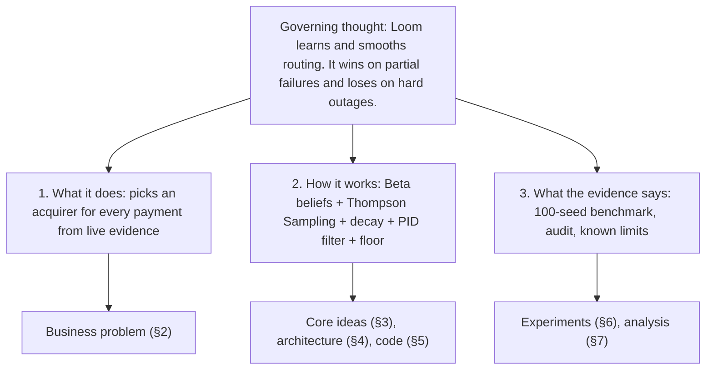
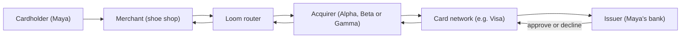
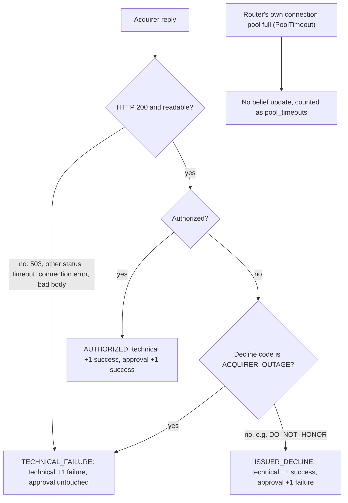
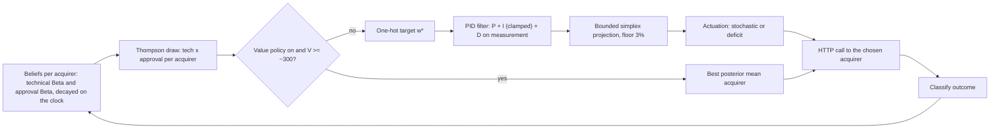
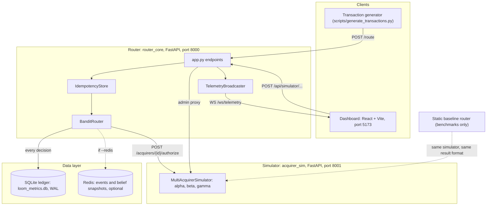
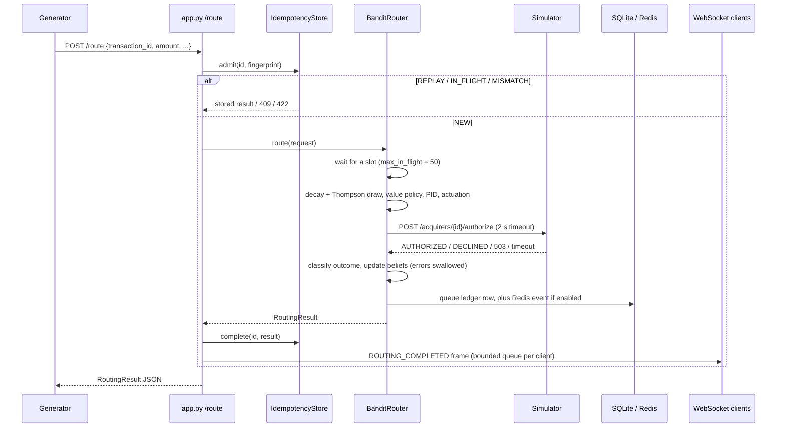
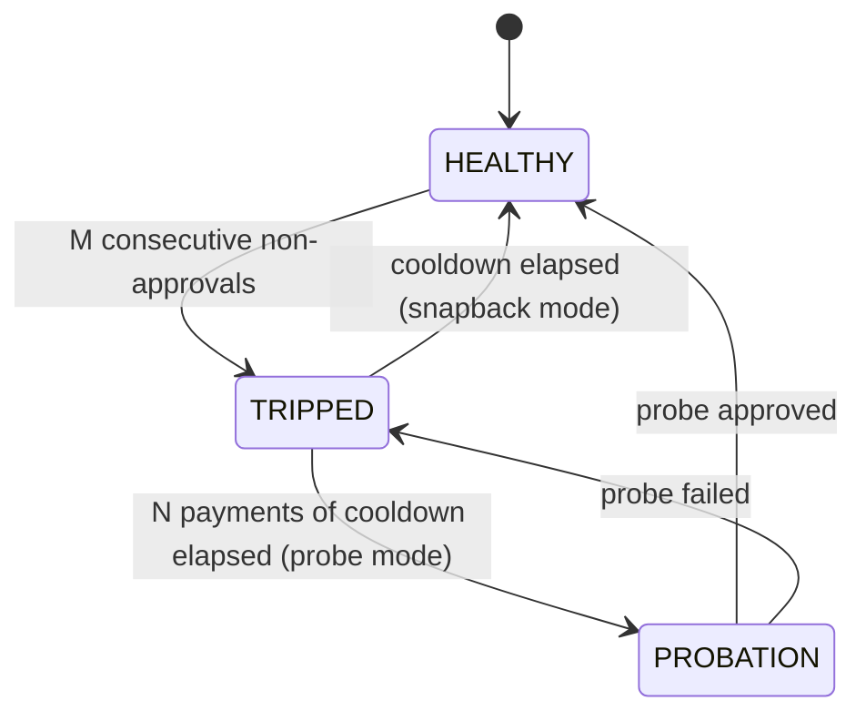

# Loom, Explained From Scratch

*A complete guide to the Loom payment-routing experiment: the problem, the maths, the architecture, the code, the experiments and the results.*

| Field | Value |
|---|---|
| Document code | `LOOM-00-018` (front matter) |
| Describes code at | branch `audit-value-dispatch-dashboard`, commit `cc6bb59` |
| Sources of truth | The code first, then [README.md](README.md), [docs/AUDIT.md](docs/AUDIT.md), [docs/WHITEPAPER_L1.md](docs/WHITEPAPER_L1.md), [docs/decisions-log.md](docs/decisions-log.md) |
| Length | About 7,300 words of prose, plus diagrams and tables. A first read takes about 45 minutes. |

---

## 0. How to read this document `LOOM-00-018`

**Bottom line:** read §1 for the answer, and then follow the path for your role. Each section stands on its own.

### 0.1 Who this is for

| You are… | You want… | Read |
|---|---|---|
| **A newcomer** (no payments or maths background) | To understand what Loom is and whether it works | §1 → §2 → §3.1–3.4 → §7 → §10 |
| **An engineer** | To change or run the code | §1 → §3 → §4 → §5 → §8 |
| **A reviewer** | To judge the claims | §1 → §6 → §7 |

### 0.2 How this document is built

Several writing frameworks shape this document. You do not need to know them to read it.

- **Minto Pyramid.** The answer comes first. Each section opens with a **Bottom line**, and the supporting detail follows.
- **DITA topic types.** Each section has one job, shown in its heading:
  - *Concept*: what something is and why it exists.
  - *Reference*: tables you look things up in.
  - *Task*: steps you follow.
  - *Troubleshooting*: limits and failure modes.
  - *Glossary*: definitions.
- **S1000D-style data module codes**, in a simplified form. Each section has a code `LOOM-<system>-<info>`.
  - System: `00` whole system, `10` router core, `20` simulator, `30` data layer, `40` baseline router, `50` dashboard, `60` scripts.
  - Info: `018` introduction, `040` description, `042` how it works, `300` tests and experiments, `400` faults and limits, `005` abbreviations, `006` terms.
  - Safety-style callouts flag risks: **WARNING** (a claim you could get badly wrong), **CAUTION** (a trap that costs time or accuracy) and **NOTE** (useful context).
- **DERA** (Design, Experiment, Result, Analysis). Every experiment in §6 uses these four parts in this order.
- **ISO 24495-1 plain language and ASD-STE100 Simplified Technical English.** Sentences are short and in active voice. Each term is defined the first time it appears. Procedures (§8) use one instruction per sentence.
- **Cognitive load.** Each idea arrives in three layers: first a picture, then numbers, then the formula. Skip the formula layer if you only need the idea.

### 0.3 One running example

Maya buys running shoes online. Her payment can go through one of three **acquirers**: Alpha, Beta or Gamma. An acquirer is a company that sends a shop's card payments into the card network. Loom decides which acquirer gets Maya's payment. We return to Maya throughout.

### 0.4 Notation

| Symbol | Meaning | Default |
|---|---|---|
| $\alpha, \beta$ | Success and failure tallies of a belief | — |
| $\alpha_0, \beta_0$ | Prior tallies (the starting belief) | Technical $(4,1)$, approval $(1,1)$ |
| $\theta$ | A success rate between 0 and 1 | — |
| $h$ | Half-life of evidence, in seconds | 2.3 s (served), 0.9 s (benchmark), 60 s (approval) |
| $f$ | Decay multiplier, $f = 0.5^{\Delta t / h}$ | — |
| $\gamma$ | Per-observation decay factor (older mode) | — |
| $w_i$ | Allocation weight: the share of traffic for acquirer $i$ | — |
| $w^*$ | Target weight from the bandit (one-hot) | — |
| $e$ | Error, $w^* - w$, centred to sum to zero | — |
| $K_p, K_i, K_d$ | PID gains | 0.12, 0.005, 0.25 |
| $I_{\max}$ | Integral clamp | 1.0 |
| $w_{\min}$ | Exploration floor | 0.03 |
| $V, \tau, \lambda$ | Payment value, value scale, shrinkage | $\tau = 100$ |

---

## 1. Executive summary `LOOM-00-040` *(Concept)*

**Bottom line:** Loom is a payment router that learns and smooths its own decisions. It beats a standard circuit breaker when an acquirer partly fails, and it loses when an acquirer fails completely. Its strongest parts are the simulator, the benchmark harness and its honest measurement, not the router itself.

### 1.1 The story in four lines (SCQA)

- **Situation.** A shop sends each card payment through one of several acquirers. Every failed payment is lost revenue.
- **Complication.** Acquirers fail without warning. The usual fix is a fixed rule such as "after 3 failures in a row, switch". That rule either overreacts or reacts too late. It is also blind to partial failures.
- **Question.** Can a router learn acquirer health from live outcomes and move traffic smoothly, and still beat the fixed rule?
- **Answer.** Partly.
  - Loom learns health with **Thompson Sampling**, a probability method.
  - It smooths traffic shifts with a **PID-style filter**, a control-engineering tool.
  - Across 100 paired test runs it wins against partial failures (+1.97 percentage points of success rate).
  - It loses against complete outages (−3.09 points against a 3-failure breaker).

### 1.2 The three key lines



1. **What it does.** For each payment, Loom chooses one acquirer. It learns from the result of every payment.
2. **How it works.** A belief per acquirer → a random draw from each belief → a target → a smoothing filter → a traffic share with a 3% minimum → one acquirer.
3. **What the evidence says.**
   - It wins on gray failures and against a fragile 1-failure breaker.
   - It loses on hard outages against 3- and 5-failure breakers.
   - The smoothing costs 1.45 points of success rate.
   - The benefit the smoothing is meant to buy (protecting backup acquirers from a traffic surge) is never measured. The simulator gives every acquirer unlimited capacity.

> **WARNING:** Older documents in this repository quote "+1000 bps lift". That number only holds against a deliberately weak baseline. Use the numbers in §6.5.

---

## 2. The business problem `LOOM-00-040` *(Concept)*

**Bottom line:** a merchant loses money every time a good payment fails for a technical reason, and fixed failover rules handle real failure patterns badly.

### 2.1 What happens when Maya taps "Pay"



- The **merchant** is the shop.
- The **acquirer** is the shop's payment partner. It carries the payment into the card network.
- The **card network** connects acquirers to banks.
- The **issuer** is the bank that issued Maya's card. It makes the final decision, called the **authorization**.

The full round trip takes about one second.

### 2.2 Why payments fail

There are three families of failure. The difference between them matters for everything in §3.

| Family | Example | Whose fault? | Can routing fix it? |
|---|---|---|---|
| **Customer** | Wrong card number, no money | Maya | No |
| **Issuer** | `DO_NOT_HONOR`: the bank says no | The issuer's business decision | No |
| **Technical** | Acquirer down, timeout, HTTP 503 | The acquirer | **Yes:** use another acquirer |

A **decline code** is the short reason that comes back with a refusal. `DO_NOT_HONOR` is a generic issuer refusal. In this project `ACQUIRER_OUTAGE` marks a technical failure.

### 2.3 Why success rate is the metric

The **Payment Success Rate (PSR)** is the number of approved payments divided by the number of attempted payments.

The product requirements ([docs/prd.md](docs/prd.md)) explain why PSR matters more than fees:

- A 1% drop in PSR removes 1% of all sales.
- A 0.1% fee saving is a rounding error by comparison.

Results are given in **percentage points (pp)**, the plain difference between two percentages. 1 pp = 100 **basis points (bps)**.

### 2.4 How routing is done today

Most merchants use **static priority routing**: send everything to the first acquirer on a list. A **circuit breaker** guards it. After $M$ consecutive failures, the breaker "trips" and traffic moves to the next acquirer. After a **cooldown** of $N$ payments, one **canary probe** (a single test payment) checks whether the first acquirer has recovered.

This rule fails in two opposite ways:

1. **It overreacts.** One unlucky failure can trip a sensitive breaker ($M = 1$). All traffic jumps to the backup at once. This sudden 100% shift is called **herd migration** (or a thundering herd). It can overload the backup acquirer.
2. **It underreacts.** In a **gray failure** (or brownout), an acquirer drops from 95% to 60% success without going fully down. Three failures in a row are rare at 60%, so the breaker almost never trips. Payments keep failing quietly.

The PRD puts the root cause simply: a fixed threshold has no idea of duration or trend.

### 2.5 What Loom set out to do, and what it did not

- **Goals:**
  - A live learning loop that reacts to an outage injected on demand.
  - A measurable PSR lift over a static baseline.
  - A smooth traffic curve with no step changes and no ringing.
  - Routing that is never the slow part.
- **Non-goals:**
  - Real acquirers.
  - Production hardening: multi-region deployment, PCI compliance, clustered databases, kill switches.
  - Value-scaled exploration, which was a stretch goal and was later built (§3.9).

> **NOTE:** The PRD never set a numeric target for "good enough" lift before the tests ran. The audit (F-20) records that the headline was chosen after the results were known.

**You can now:** name the actors in a card payment, the three failure families, and why fixed rules fail.

---

## 3. Core ideas, built step by step `LOOM-10-042` *(Concept)*

**Bottom line:** Loom keeps a belief about each acquirer, draws a random guess from each belief, and smooths the winner of those guesses into a traffic share that never falls below 3%.

Each subsection follows the same pattern: picture → numbers → formula → code.

### 3.1 Beliefs: how sure are we that an acquirer works?

**Picture.** Alpha approved 9 of 10 payments. Beta approved 3 of 3. Beta's record is better, but we have seen it only three times. We need a way to hold both a best guess and a level of confidence.

**Numbers.** Loom uses a **Beta distribution**, written $\text{Beta}(\alpha, \beta)$. Think of $\alpha$ as a success tally and $\beta$ as a failure tally. The shape of the distribution is our belief about the true success rate.

- $\text{Beta}(10, 2)$ has mean 0.83 and variance 0.011, a narrow peak. We are fairly sure.
- $\text{Beta}(4, 2)$ has mean 0.67 and variance 0.032, a wide hump. We are unsure.

**Formula.**

$$\mu = \frac{\alpha}{\alpha+\beta}, \qquad \sigma^2 = \frac{\alpha\beta}{(\alpha+\beta)^2(\alpha+\beta+1)}$$

The **prior** $\text{Beta}(\alpha_0, \beta_0)$ is the belief before any evidence. Each success adds 1 to $\alpha$, and each failure adds 1 to $\beta$. The result is the **posterior**. This simple update works because the Beta distribution is the **conjugate** partner of yes/no outcomes: the updated belief is still a Beta distribution.

**Code.** `AcquirerStateSnapshot.expected_success_rate` and `.variance`, [router_core/state.py:177](router_core/state.py#L177).

### 3.2 Thompson Sampling: choosing while still learning

**Picture.** Imagine several slot machines with unknown payouts. This is a **multi-armed bandit** problem; each machine is an **arm**. You face the **explore/exploit** dilemma:

- **Exploit:** play the machine that looks best.
- **Explore:** try an uncertain machine in case it is better.

**Numbers.** **Thompson Sampling** (1933) solves this neatly. For every payment, draw one random number from each acquirer's belief, and pick the highest draw.

- Alpha $=\text{Beta}(20,2)$ almost always draws near 0.91.
- Beta $=\text{Beta}(3,2)$ draws anywhere from about 0.2 to 0.95.
- Over 100,000 paired draws, Beta wins 5.7% of the time.

So the uncertain acquirer still gets an occasional payment, and its belief can improve. Exploration shrinks by itself as confidence grows.

**Why not the alternatives?** These come from the decision log:

- **ε-greedy** explores at a fixed random rate. It ignores how confident we are.
- **UCB** (Upper Confidence Bound) was viable. Its sharp, deterministic jumps fit less cleanly with the smoothing filter.

**Code.** `BanditStateRegistry.sample_all`, [router_core/bandit.py:54](router_core/bandit.py#L54).

### 3.3 Forgetting: old evidence must fade

**Picture.** Alpha worked perfectly yesterday and is down now. If Loom remembers 100,000 old successes, it needs thousands of failures to notice. Evidence must fade with time.

**Formula first, because it is short.** Loom shrinks only the evidence above the prior. This is called **offset decay** or mean-reverting decay. A belief can never fall below the prior:

$$f = 0.5^{\Delta t / h}$$
$$\alpha \leftarrow \max\big(\alpha_0,\; \alpha_0 + f(\alpha - \alpha_0) + x\big), \qquad \beta \leftarrow \max\big(\beta_0,\; \beta_0 + f(\beta - \beta_0) + (1-x)\big)$$

- $x = 1$ for a success and $x = 0$ for a failure.
- $\Delta t$ is the time since the last update, measured on the **wall clock** (real time).
- $h$ is the **half-life**: after $h$ seconds, old evidence counts half as much.

**Numbers.** These use the served half-life, $h = 2.3$ s, with traffic at 15 payments per second.

- **Memory size.** At 15 TPS the success tally can never exceed about 54. So Loom effectively remembers about 50 recent payments. An acquirer at the 3% floor receives only about 1.5 payments per half-life.
- **Outage.** After 200 successes, Alpha's belief is $\text{Beta}(53.4, 1)$, mean 0.982. Each failure then pulls the mean down:

  | Failures in a row | 1 | 3 | 5 | 10 |
  |---|---|---|---|---|
  | Mean success rate | 0.963 | 0.928 | 0.893 | 0.814 |

- **Idle recovery.** An acquirer at $\text{Beta}(4, 21)$ (mean 0.16) gets no traffic. Its belief relaxes back toward the prior on its own:

  | Seconds idle | 0 | 2.3 | 10 | 30 |
  |---|---|---|---|---|
  | Mean success rate | 0.160 | 0.267 | 0.669 | 0.800 (the prior) |

**Why offset decay?** The decision log rejected two alternatives:

- **Plain decay** ($\gamma\alpha + x$) lets $\alpha$ or $\beta$ fall below 1. The Beta density then misbehaves.
- **Sliding windows** drop old data abruptly and make the belief jump.

**Two modes exist:**

- **Wall-clock mode** (current default, PR #3) uses the $f$ above.
- **Per-observation mode** (older) multiplies by a fixed $\gamma$ at each payment, for example $\gamma = 0.98$. In this mode an acquirer that gets no traffic never forgets. In Phase 3 this starved a recovered acquirer.

**A separate health score.** In wall-clock mode Loom also computes a **health score**: the decayed success fraction plus one optimistic pseudo-observation, $(s+1)/(s+f'+1)$. Here $s$ and $f'$ are the evidence above the prior. It is logged and shown on the dashboard. It is **not** used for routing.

> **CAUTION:** In wall-clock mode the health score is **not** an EWMA (exponentially weighted moving average). It is an EWMA only in per-observation mode. Several older documents describe it wrongly.

**Code.** `decay_beliefs` [state.py:116](router_core/state.py#L116), `step_beliefs` [state.py:127](router_core/state.py#L127), `AcquirerStateConfig.wall_clock_health` [state.py:109](router_core/state.py#L109).

### 3.4 Two beliefs per acquirer: blame the right party

**Picture.** Maya's bank declines her card with `DO_NOT_HONOR`. Alpha did its job perfectly; the bank said no. Before PR #4, Loom blamed Alpha anyway (audit finding F-02). Now each acquirer has two beliefs:

| Belief | Question it answers | Prior | Half-life |
|---|---|---|---|
| **Technical** | Did the acquirer process the payment? | $\text{Beta}(4,1)$ (optimistic) | 2.3 s |
| **Approval** | Given that it processed it, did the issuer approve? | $\text{Beta}(1,1)$ (no opinion) | 60 s |

The Thompson score multiplies one draw from each:

$$\hat\theta_i = \hat\theta_{i,\text{tech}} \times \hat\theta_{i,\text{app}}$$

The router sorts each result into one of three **outcomes**:



**Numbers.**

- After 300 approvals, 10 issuer declines leave technical at 0.982 and approval at 0.961, so the expected product is 0.943.
- Ten technical failures instead drop technical to 0.816, so the product is 0.813.

The acquirer is punished only for its own faults.

**Choice of prior.** The technical prior $\text{Beta}(4,1)$ was picked from a sweep (§6.6). It helps a recovered acquirer earn traffic back sooner.

**Code.** `Outcome` [state.py:23](router_core/state.py#L23), `AcquirerState.record_outcome` [state.py:277](router_core/state.py#L277), `step_approval` [state.py:158](router_core/state.py#L158), classification in `BanditRouter.route` around [router.py:409](router_core/router.py#L409).

### 3.5 Why a raw bandit lurches

If every payment goes straight to the highest draw, traffic flips between 0% and 100%. Plotted over time, this looks like a **square wave**. When two acquirers are close, the winner changes almost at random. This rapid switching is called **route chatter** or flapping.

In Phase 3, the raw bandit flipped 13 times in 50 outage payments. Some flips came from draw differences as small as 0.0013. Loom's answer is to smooth the bandit's choice before acting on it.

### 3.6 The PID smoothing filter

**Picture.** Think of a car's cruise control easing towards a target speed instead of jumping to it. A **PID controller** (Proportional–Integral–Derivative) does this for any quantity. Its parts are:

- the **setpoint**: where you want to be;
- the **measurement**: where you are now;
- the **error**: setpoint minus measurement.

**How Loom wires it.**

- The setpoint $w^*$ is **one-hot**: 1.0 for this payment's Thompson winner and 0.0 for everyone else.
- The measurement is Loom's own current weight vector $w$.
- Errors are **centred** (the mean is subtracted) so they sum to zero. This keeps the total traffic at 100%.

$$e_i = (w^*_i - w_i) - \overline{(w^* - w)}$$

The three terms:

| Term | Formula | Role | Default |
|---|---|---|---|
| **P** | $K_p e_i$ | Move a fixed fraction of the gap | $K_p = 0.12$ |
| **I** | $K_i \cdot \text{clamp}\big(\sum e_i\,\Delta t, \pm I_{\max}\big)$, re-centred | Remove persistent offset | $K_i = 0.005$, $I_{\max} = 1.0$ |
| **D** | $-K_d \,(w_i - w_i^{\text{prev}})/\Delta t$ | Brake fast movement | $K_d = 0.25$ |

$$w^{\text{new}} = \text{Project}\big(w + P + I + D\big)$$

**Two classic fixes are built in:**

1. **Anti-windup.** The 3% floor means the one-hot target can never be reached. The integral would grow forever, which is called **integral windup**. Loom clamps it to $\pm I_{\max}$. (`integral_decay` exists for a "leaky" integrator; its default of 1.0 means no leak.)
2. **Derivative on measurement.** The target jumps between 0 and 1 from payment to payment. Differentiating the error would produce huge spikes, called **derivative kick**. Loom differentiates its own smooth output instead.

**Numbers.** Alpha starts at 0.5 and keeps winning. The table shows Alpha's terms at each step:

| Step | Error | P | I | D | New $w_A$ |
|---|---|---|---|---|---|
| 1 | 0.500 | 0.0600 | 0.0025 | 0.0000 | 0.5625 |
| 2 | 0.4375 | 0.0525 | 0.0047 | −0.0156 | 0.6041 |
| 3 | 0.3959 | 0.0475 | 0.0050 (clamped) | −0.0104 | 0.6462 |
| 4 | 0.3538 | 0.0425 | 0.0050 | −0.0105 | 0.6831 |
| 5 | 0.3169 | 0.0380 | 0.0050 | −0.0092 | 0.7169 |

In this example no step exceeds 6.25%, and a constant winner reaches the 0.97/0.03 limit after about 20 payments. In the benchmark, where the winner changes and the weights swing, the largest single step is about 12% (§6.2).

> **WARNING:** Despite its name, this is **not** feedback on payment outcomes. The PID never sees an approval or a failure. Its only input is the bandit's choice, so in effect it is a **low-pass filter** on the bandit's output. Outcomes reach it only through the beliefs (audit F-08).

> **NOTE:** $\Delta t = 1$ per **payment**, not per second. Ramp time therefore depends on traffic volume. The audit measured a ramp of about 0.06 s at 1,000 TPS and 34–45 s at 0.5 TPS.

**Code.** `PIDConfig` [pid.py:12](router_core/pid.py#L12), `calculate_pid_step` [pid.py:197](router_core/pid.py#L197).

### 3.7 The 3% floor and simplex projection

**Picture.** If Alpha's weight reaches zero, Alpha never gets a payment. Its recovery would then go unnoticed. Loom therefore guarantees every acquirer at least $w_{\min} = 3\%$. This is the **exploration floor**.

Valid weight vectors live on the **probability simplex**: every weight is ≥ 0 and the weights add up to 1. The **bounded simplex** adds the floor: every weight is ≥ 0.03. After each PID step, Loom pushes the vector back into this space.

**Algorithm** (`project_to_bounded_simplex`, [pid.py:135](router_core/pid.py#L135)):

1. Raise every weight to at least the floor.
2. If the sum is above 1, take the excess from weights above the floor, in proportion to their distance above it.
3. If the sum is below 1, add the shortfall in proportion to each weight.
4. Renormalise, keeping the floor.

**Numbers.**

| Input | Output |
|---|---|
| (1.05, −0.05) | (0.97, 0.03) |
| (0.98, 0.00, 0.10) | (0.878, 0.030, 0.092) |
| (0.5, 0.3) | (0.625, 0.375) |

> **NOTE:** This is a practical heuristic. It is not the mathematically closest (Euclidean) projection.

### 3.8 Actuation: from a share to one acquirer

**Actuation** turns a weight vector into a single decision. Each payment still goes 100% to one acquirer. Loom has two modes:

| Mode | How it picks | Used by |
|---|---|---|
| **Stochastic** | A weighted random draw: Alpha with probability $w_A$ | **The served app** (the `PIDConfig` default) |
| **Deficit** | A Bresenham-style scheduler. It adds each weight to a running quota and picks the acquirer most "owed" a payment. | **The benchmark** |

For weights (0.7, 0.3), deficit actuation gives `ABAABAAABA`: exactly 7 and 3. Ten stochastic draws give anywhere from 5 to 9 As. Actuation lives in `BanditRouter.route` at [router.py:318](router_core/router.py#L318).

### 3.9 Value-scaled policy: protect big payments

**Picture.** Exploration means some payments go to the less certain acquirer on purpose. That is fine for a $5 coffee. It is a bad idea for a $5,000 laptop. Phase 8 adds a value-aware layer. It is **off by default** everywhere.

**Formula.** The shrinkage is

$$\lambda(V) = 1 - e^{-V/\tau}, \qquad \tau = 100$$

| Payment $V$ | 10 | 100 | 250 | 300 | 1,000 |
|---|---|---|---|---|---|
| $\lambda$ | 0.095 | 0.632 | 0.918 | 0.950 | ≈1 |

- **If $\lambda \ge 0.95$** (that is, $V \ge \tau \ln 20 \approx 300$), the payment is **protected**. It goes to the acquirer with the highest posterior mean (technical mean × approval mean). It skips the PID and the draw.
- **Otherwise**, each sample is blended toward its mean: $(1-\lambda)\hat\theta_i + \lambda\mu_i$.

> **NOTE:** With the PID on, blending alone changes almost nothing (audit F-10). That is why protection at dispatch was added in Phase 4b (PR #7).

**Code.** `ValueScaledExplorationConfig` [value_policy.py:10](router_core/value_policy.py#L10), `apply_value_scaled_policy` [value_policy.py:58](router_core/value_policy.py#L58), `best_posterior_mean` [value_policy.py:77](router_core/value_policy.py#L77).

### 3.10 The whole loop on one page



**You can now:** explain how Loom turns outcomes into beliefs, beliefs into a target, and a target into one acquirer, and say what each constant does.

---

## 4. Architecture `LOOM-00-040` *(Concept)*

**Bottom line:** Loom is five Python and JavaScript parts around one FastAPI router. A simulator stands in for real acquirers, so outages can be injected on command.

### 4.1 System context



The repository maps onto these parts:

| Folder | Phase | Job |
|---|---|---|
| [router_core/](router_core/) | 1, 3, 4, 8 | Beliefs, bandit, PID, value policy, HTTP service |
| [acquirer_sim/](acquirer_sim/) | 2 | Fake acquirers with switchable outages |
| [data_layer/](data_layer/) | 5 | SQLite ledger, Redis events and snapshots, CLI |
| [baseline_router/](baseline_router/) | 6 | Static priority router with a circuit breaker |
| [dashboard/](dashboard/) | 7 | Live operator view and outage controls |
| [scripts/](scripts/) | all | Demo launcher, generator, benchmarks, QA scripts |
| [tests/](tests/) | all | 358 Python tests; the dashboard has 27 Vitest tests |

### 4.2 One payment, step by step



Points worth noticing:

- **Payments never wait on storage.** Ledger and Redis writes go into bounded queues. Background workers drain them.
- **A belief-update failure cannot turn an approved payment into an error.** The update is wrapped and its errors are swallowed.
- **Each acquirer has its own HTTP connection pool.** This is a **bulkhead**: one slow acquirer cannot use up connections for the others.
- **At most 50 payments are dispatched at once.** This is **admission control**. The rest wait and then decide with fresher beliefs. The wait is reported as `queue_wait_ms`.

### 4.3 The baseline router's circuit breaker

The comparison router ([baseline_router/router.py](baseline_router/router.py)) is a state machine for each route:



- Defaults: $M = 3$, $N = 30$, probe mode.
- If every route is tripped, it falls back to the primary, even if the primary is dead.
- It counts **every** non-approval as a route failure, including issuer declines. It has no outcome attribution.

### 4.4 Two configurations: do not mix them up

| Setting | Served app (`router_core.server`, `run_demo.py`) | Benchmark (`scripts/compare_psr.py`) |
|---|---|---|
| Acquirers | alpha, beta, gamma | alpha (95%), beta (94%) |
| Simulator base rate | 0.95 each, by default | Set by the script |
| Clock | Real time | Virtual, 15 TPS |
| Technical half-life | 2.3 s | 0.9 s |
| Actuation | **Stochastic** (no CLI flag to change it) | **Deficit** |
| Ledger | On | In memory (multi-seed) |
| Value policy | Off | Off (on in `value_policy_outage.py`) |

> **CAUTION:** The dashboard sliders start at 0.95 / 0.90 / 0.85. Those are user-interface values only. The simulator itself starts all three acquirers at 0.95.

### 4.5 Key architecture decisions

| Decision | Rejected alternatives | Why | Status |
|---|---|---|---|
| Thompson Sampling | ε-greedy, UCB | Exploration follows confidence; fits the smoothing filter | Current |
| Offset decay toward the prior | Plain decay, sliding window | Never goes below the prior; no jumps | Current |
| Wall-clock decay ($h$ = 2.3 s) | Per-observation $\gamma$ | Idle acquirers forget too (fixes starvation) | PR #3 |
| Split technical and approval beliefs | One belief | Do not blame acquirers for issuer declines | PR #4 |
| Pure-function PID step | Stateful class | Deterministic and testable | Current |
| Derivative on measurement | Derivative on error | No derivative kick | Current |
| Integral clamp ±1.0 | Unbounded, back-calculation | The target is unreachable under the floor | Current |
| 3% floor via projection | Background probing ticker | Prevents starvation at the actuator | Current |
| Simulated acquirers only | Real sandbox | A sandbox cannot fail on command | Current |
| No retry on a second acquirer | Inline cascade | A retry would hide failures from the bandit | Current |
| Value policy as shrinkage, then dispatch protection | Hard dollar cutoffs, dollar-weighted updates | Smooth in value; actually protects with the PID on | PR #7 |
| Per-process idempotency (24 h, 100k IDs) | None | Duplicate requests must not route twice | PR #5 |
| Admission limit, 50 in flight | Unlimited; "virtual loss" | Cuts payments sent to a dead acquirer in bursts | PR #5 |
| Append-only SQLite ledger | Mutable tables | Guards against accidental edits (not tampering) | Current |

**You can now:** draw the system, trace one payment through it, and say which configuration a number came from.

---

## 5. Code reference `LOOM-10…60-040` *(Reference)*

**Bottom line:** look up any class, function, endpoint or constant here.

### 5.1 Key classes and functions

| Name | Where | What it does |
|---|---|---|
| `Outcome` | [state.py:23](router_core/state.py#L23) | `AUTHORIZED`, `ISSUER_DECLINE`, `TECHNICAL_FAILURE` |
| `AcquirerStateConfig` | [state.py:46](router_core/state.py#L46) | Priors, half-lives; `half_life_sec` or `decay_factor`, not both |
| `decay_beliefs(config, α, β, elapsed)` | [state.py:116](router_core/state.py#L116) | Wall-clock offset decay |
| `step_beliefs(...)` / `step_approval(...)` | [state.py:127](router_core/state.py#L127), [:158](router_core/state.py#L158) | Decay, then add one outcome |
| `AcquirerState.record_outcome(success, timestamp, outcome)` | [state.py:277](router_core/state.py#L277) | Routes one outcome to both beliefs |
| `AcquirerState.sample(rng, now)` | [state.py:313](router_core/state.py#L313) | Decays, then draws `rng.beta(α, β)` |
| `BanditStateRegistry.sample_all(rng, now)` | [bandit.py:54](router_core/bandit.py#L54) | Technical draw × approval draw per acquirer |
| `PIDConfig` | [pid.py:12](router_core/pid.py#L12) | Gains, clamp, floor, actuation mode |
| `project_to_bounded_simplex(weights, min_floor)` | [pid.py:135](router_core/pid.py#L135) | Puts weights back on the simplex with the floor |
| `calculate_pid_step(target, current, state, config, dt)` | [pid.py:197](router_core/pid.py#L197) | One pure PID step; returns weights, next state, diagnostics |
| `ValueScaledExplorationConfig` | [value_policy.py:10](router_core/value_policy.py#L10) | `tau`, `protect_lambda`, `calculate_shrinkage`, `protects` |
| `RouterConfig` / `AcquirerRouteConfig` | [models.py:54](router_core/models.py#L54), [:15](router_core/models.py#L15) | Routes, pools, `max_in_flight`, seed, PID, value policy |
| `RoutingResult` | [models.py:110](router_core/models.py#L110) | The full record of one decision |
| `BanditRouter.route(request)` | [router.py:235](router_core/router.py#L235) | The whole pipeline in §4.2 |
| `IdempotencyStore.admit / complete / abandon` | [idempotency.py:57](router_core/idempotency.py#L57) | Deduplicates by `transaction_id` and a body fingerprint |
| `fingerprint(body)` | [idempotency.py:50](router_core/idempotency.py#L50) | Canonical sorted JSON of the body without `transaction_id` |
| `TelemetryBroadcaster` | [telemetry.py:18](router_core/telemetry.py#L18) | One 256-frame queue per client; drops the oldest frame when full |
| `create_router_app(...)` | [app.py](router_core/app.py) | Builds the FastAPI app and its background workers |
| `AcquirerSimulator.execute_authorization` | [simulator.py:129](acquirer_sim/simulator.py#L129) | Latency, outage behaviour, random approval |
| `MultiAcquirerSimulator` | [simulator.py:243](acquirer_sim/simulator.py#L243) | Holds several acquirers with separate seeds |
| `StaticBaselineRouter.select_route / route` | [baseline_router/router.py:184](baseline_router/router.py#L184) | Priority failover with a breaker |
| `MetricsLogger` | [sqlite_logger.py:199](data_layer/sqlite_logger.py#L199) | Batched async SQLite writer (batch 20, 50 ms, queue 10,000) |
| `RedisSidecar` | [live.py:34](data_layer/live.py#L34) | Publishes events; snapshots beliefs every 5 s; restores on start |
| `trackSequence(stream, seq, streamId)` | [telemetryState.js:62](dashboard/src/hooks/telemetryState.js#L62) | Detects dropped frames and router restarts |
| `useLoomTelemetry()` | [useLoomTelemetry.js:26](dashboard/src/hooks/useLoomTelemetry.js#L26) | WebSocket client: 120-event history, reconnect with backoff |

### 5.2 Router endpoints (port 8000)

| Method | Path | Purpose |
|---|---|---|
| POST | `/route` | Route one payment. A duplicate returns the stored result with `replayed: true`. A duplicate still in flight returns **409**. The same ID with a different body returns **422**. |
| GET | `/health` | Status, ledger, Redis, dropped telemetry, pool timeouts, admission data |
| GET | `/state`, `/state/{id}` | Current beliefs (404 if the ID is unknown) |
| WS | `/ws/telemetry` | Live frames (see §5.4) |
| POST | `/api/simulator/acquirers/{id}/outage` | Proxy to the simulator; then broadcasts `HEALTH_ALERT` |
| POST | `/api/simulator/acquirers/{id}/success-rate` | Proxy |
| GET / POST | `/api/simulator/admin/states`, `/admin/reset` | Proxy |

If the simulator is unreachable, returns a 5xx, or returns a body that is not JSON, the proxy answers **502**. Upstream 4xx errors pass through unchanged.

### 5.3 Simulator endpoints (port 8001)

| Method | Path | Purpose |
|---|---|---|
| POST | `/acquirers/{id}/authorize` | Authorize. Unknown IDs are created automatically. |
| POST | `/authorize` | Same; the target comes from a header, query or body |
| POST | `/admin/outage`, `/admin/success-rate`, `/admin/reset` | Fault injection (404 for unknown IDs) |
| GET | `/admin/states`, `/health`, `/acquirers` | Inspection |

**Outage behaviours:**

| Behaviour | Response | How the router classifies it |
|---|---|---|
| `RETURN_DECLINE` (default) | HTTP 200 with `ACQUIRER_OUTAGE` | Technical failure |
| `HTTP_503` | Service unavailable | Technical failure |
| `LATENCY_SPIKE` | Adds 2.5 s; the router's 2 s timeout fires first | Technical failure |

Normal latency is 20 ms ± 5 ms. Outside an outage, every decline is `DO_NOT_HONOR`.

### 5.4 WebSocket frames

| `event_type` | When | Key fields |
|---|---|---|
| `BOOTSTRAP` | On connect | `stream_id`, last `sequence_number`, `states`, `registered_acquirers` |
| `ROUTING_COMPLETED` | Every payment | `stream_id`, `sequence_number`, `selected_acquirer`, status, latencies, `thompson_samples`, `target_allocation`, `smoothed_allocation`, `updated_state` |
| `HEALTH_ALERT` | After an operator outage toggle | `old_health`, `new_health`, `severity`, `message` |
| `PONG` | Reply to `"ping"` | — |

- `stream_id` is a new random ID for each router process.
- Sequence numbers start at 1 and follow completion order.
- If the dashboard sees a sequence gap, it counts dropped frames and breaks the chart line.
- A new `stream_id`, or a number that goes backwards, means the router restarted.

### 5.5 Ledger schema ([data_layer/schema.sql](data_layer/schema.sql))

- **`transactions`**: one row per decision.
  - `transaction_id` is unique.
  - Other columns: chosen acquirer, weight, status, `outcome`, latencies, and JSON copies of the samples, target, smoothed weights and PID diagnostics.
- **`acquirer_outcomes`**: the belief state after each decision: `alpha`, `beta`, the approval tallies, `expected_psr` and the health score.
- **Triggers**: four `BEFORE UPDATE` / `BEFORE DELETE` triggers raise `RAISE(ABORT)`, making both tables append-only.
- **Settings**: WAL journal mode, `busy_timeout` 5 s.

> **CAUTION:** The triggers stop accidents, not tampering. `DROP TRIGGER`, `INSERT OR REPLACE`, `DROP TABLE` and `reset-demo` all bypass them.

---

## 6. Experiments `LOOM-60-300` *(DERA)*

**Bottom line:** across 100 paired runs, Loom beats a fragile breaker and gray failures, loses to sensible breakers on hard outages, and pays a small price for smoothing.

### 6.0 Shared method

Most experiments use the same **gauntlet**, a fixed test schedule:

- **Acquirers:** Alpha at 95% and Beta at 94%.
- **Schedule:** 150 payments in three stages. Payments 1–50 are warmup. Payments 51–100 are an outage on Alpha (0% success, or 60% for gray failure). Payments 101–150 are recovery.
- **Clock:** a virtual clock advances 1/15 s per payment (15 TPS).
- **Seeds:** a **seed** fixes a random-number stream, so a run can be repeated exactly. Run $k$ uses simulator seed $42 + 10k$ and Loom seed $777 + k$.
- **Paired comparison:** Loom and each rival run on the same simulator seed. We then average the per-seed differences $d_k$:

$$\bar d \pm t_{0.975,\,n-1}\,\frac{s_d}{\sqrt n}$$

This is a 95% **confidence interval (CI)** from the t-distribution. If the interval does not include 0, the difference is unlikely to be luck.

> **CAUTION:** The simulator draws each acquirer's results from its own random stream. So two routers do not see identical outcomes at the same payment index. Pairing reduces noise; it does not remove it.

### 6.1 E1: Raw bandit, chatter and starvation (Phase 3)

- **Design.** Thompson Sampling with no PID and per-observation decay. One seed (42/777).
- **Experiment.** [docs/phase3-qa-report.md](docs/phase3-qa-report.md), `scripts/run_qa_oscillation_scenario.py`.
- **Result.**
  - 13 route flips during the outage, including A-B-A-B-A chatter at payments 53–57.
  - The recovered Alpha got **0 of 50** recovery payments. Its belief was frozen at a mean of 0.617.
- **Analysis.** This experiment proved both problems that Loom's later design solves. Chatter motivated the PID. Starvation motivated the 3% floor and then wall-clock decay.

### 6.2 E2: PID gain tuning (Phase 4)

- **Design.**
  - Grid: $K_p$ 0.05–0.40, $K_i$ 0.001–0.05, $K_d$ 0.05–0.50.
  - Gates: weight step ≤ 15%, overshoot < 5%, at most 2 flips.
- **Experiment.** `scripts/tune_pid_gains.py`.
- **Result.**
  - $K_p = 0.5$ rang, with 48.5% jumps.
  - $K_p = 0.02$ was sluggish.
  - $K_d = 0$ rebounded to 0.63.
  - The chosen gains (0.12 / 0.005 / 0.25) gave a largest weight step of 11.77% at the time. It is now 11.65% at seed 42, and 11.6–12.4% across 100 seeds.
- **Analysis.**
  - The gains were tuned **in-sample**, on the same seed later used to report results.
  - The claimed "monotonic" easing is false: the weight briefly moves toward the failed acquirer.
  - The gate "recovered leader gets ≥ 15% of traffic" was not met.

### 6.3 E3: Integral windup stress

- **Design.** A 200-payment outage, run with and without the clamp.
- **Experiment.** `scripts/qa_pid_comparison_and_windup_stress.py`.
- **Result.**
  - Without the clamp, the integral reached −8.99.
  - With the clamp, the response was immediate.
  - In the closed loop, bounded and unbounded integrators **behaved the same**.
- **Analysis.** The clamp is sound practice, but this test does not show that it changes outcomes.

### 6.4 E4: Static baseline pathologies (Phase 6)

- **Design.** The baseline router on the gauntlet, seed 42.
- **Experiment.** `scripts/run_qa_baseline_scenario.py`.
- **Result:**

  | Configuration | Global PSR | Outage PSR | Failures on Alpha |
  |---|---|---|---|
  | $M=3$, probe | 92.00% | 82.0% | 4 |
  | $M=1$ | 76.00% | 38.0% | 30 |
  | $M=5$ | 90.67% | 80.0% | 6 |
  | $M=3$, snapback | 90.67% | 80.0% | 6 |
  | $M=3$, gray 60% | 88.67% | 78.0% | 8 |

- **Analysis.**
  - $M=1$ collapses because of a chain of events. One routine `DO_NOT_HONOR` on Beta at payment 57 trips Beta. Both routes are then tripped, so the fallback sends payments 58–86 to the dead Alpha.
  - In the gray failure, the breaker barely reacts.

### 6.5 E5: The headline comparison (100 paired seeds)

- **Design.** The gauntlet, with Loom in benchmark configuration and 100 seeds.
- **Experiment.** `python scripts/compare_psr.py --n-seeds 100`, written to [dashboard/src/data/baselineComparison.json](dashboard/src/data/baselineComparison.json).
- **Result:**

  | Comparison (Loom − other) | Mean difference | 95% CI | Loom wins / ties / losses |
  |---|---|---|---|
  | vs static $M=1$ | **+13.57 pp** | [+12.13, +15.00] | 91 / 0 / 9 |
  | vs static $M=3$ | **−3.09 pp** | [−3.74, −2.44] | 14 / 5 / 81 |
  | vs static $M=5$ | **−1.85 pp** | [−2.50, −1.21] | 24 / 6 / 70 |
  | vs $M=3$, gray failure (60%) | **+1.97 pp** | [+1.14, +2.80] | 63 / 7 / 30 |
  | PID Loom vs raw bandit | **−1.45 pp** | [−1.84, −1.05] | 16 / 6 / 78 |

  Mean global PSR by configuration:

  | Configuration | Mean PSR |
  |---|---|
  | Loom | 89.19% |
  | Raw bandit | 90.64% |
  | $M=1$ | 75.63% |
  | $M=3$ | 92.29% |
  | $M=5$ | 91.05% |
  | Loom, gray failure | 90.33% |
  | $M=3$, gray failure | 88.36% |

  On average during the outage:

  | Configuration | Failures on Alpha | Route flips |
  |---|---|---|
  | Loom | 8.16 | 12.13 |
  | Raw bandit | 5.94 | 7.13 |
  | $M=3$ | 3.91 | 3.01 |

- **Analysis.**
  - A breaker cuts traffic at once. Loom's ramp moves about 12% per payment, so it absorbs more failures.
  - Because the simulator has unlimited capacity, the abrupt cut costs the breaker nothing.
  - Gray failure is where Loom earns its keep: at 60% success, three failures in a row are rare.
  - The PID does **not** reduce flips. Deficit actuation alternates acquirers by design.

> **WARNING:** The single-seed result (Loom 86.00% vs $M=3$ 92.00%) is one draw. Across seeds, Loom ranged from 80.00% to 96.67%. Always quote the 100-seed table.

### 6.6 E6: Technical prior sweep

- **Design.** The 100-seed gauntlet with $\text{Beta}(n,1)$ technical priors.
- **Experiment.** `compare_psr.py --alpha-prior n`.
- **Result** (hard-outage PSR / recovery payments to Alpha / gray PSR):

  | Prior | Hard-outage PSR | Recovery payments to Alpha | Gray PSR |
  |---|---|---|---|
  | $(1,1)$ | 89.13 | 2.94 | 89.85 |
  | $(2,1)$ | 89.35 | 3.94 | 90.19 |
  | **$(4,1)$** | **89.19** | **5.79** | **90.33** |
  | $(9,1)$ | 88.59 | 8.22 | 90.56 |

- **Analysis.** A more optimistic prior wins back the recovered acquirer faster and costs a little in the outage. $(4,1)$ is the chosen compromise.

### 6.7 E7: Steady-state regret

- **Design.** No outage. Alpha is at 95%; Beta is at 94%, 92% or 90%. We measure the share of payments 501–2000 sent to the worse Beta, over 10 seeds.
- **Experiment.** `python scripts/steady_state_share.py` (add `--config served` for the served configuration).
- **Result:**

  | Beta rate | Benchmark config | Served config | Before split beliefs |
  |---|---|---|---|
  | 94% | 36.8% | 43.9% | ~46% |
  | 92% | 16.6% | 9.0% | 29–39% |
  | 90% | 10.3% | 6.3% | 19–31% |

- **Analysis.**
  - **Regret** is the cost of not always choosing the best option. Here it stays high for close acquirers.
  - Telling 95% from 94% apart needs about 4,000 observations per acquirer. Loom's memory of about 50 payments cannot get there.
  - The floor alone would give only 3%.

### 6.8 E8: Bursts of concurrent payments

- **Design.** 200 concurrent payments during a 503 outage on Alpha, 10 seeds.
- **Experiment.** `python scripts/concurrency_inflight.py --seeds 10`.
- **Result** (payments sent to the dead acquirer):

  | Setup | Stochastic | Deficit |
  |---|---|---|
  | No admission limit | 122.7 | 84.8 |
  | **Limit of 50 in flight** | **39.9** | **28.6** |
  | One at a time | 14.5 | 10.6 |

- **Analysis.**
  - Payments that start together all decide on the same stale beliefs. This is called **in-flight lag**.
  - The limit cuts the damage by about two-thirds.
  - The limit also caps throughput at roughly `max_in_flight ÷ latency`, for example 50 / 0.3 s ≈ 166 TPS.

### 6.9 E9: Value-scaled protection with the PID on

- **Design.**
  - Two acquirers at 95% and an outage on Alpha.
  - Every fifth outage payment is worth 5,000 ($\tau = 100$).
  - 30 seeds.
- **Experiment.** `python scripts/value_policy_outage.py`.
- **Result** (high-value payments sent to the dead Alpha, out of 10):

  | Actuation | Off | Blending only | **Protection** |
  |---|---|---|---|
  | Deficit | 1.57 | 1.43 | **0.50** |
  | Stochastic | 2.03 | 1.93 | **0.60** |

- **Analysis.**
  - Protection works.
  - Under deficit actuation, every protected payment that still reached Alpha was the first outage payment, sent before any failure was seen.
  - **Cost 1:** low-value payments carry more of the exploration (17.9% vs 14.8% to the dead acquirer, under stochastic actuation).
  - **Cost 2:** high-value payments never probe a recovered acquirer (0 of 10).

### 6.10 E10: Live telemetry speed

- **Design.** The served stack on local loopback, single runs.
- **Experiment.** `scripts/qa_phase7_live_verification.py`.
- **Result:**

  | Measurement | Result |
  |---|---|
  | `POST /route` to WebSocket frame received | mean 8.20 ms, p95 11.87 ms |
  | Pure server push | mean 0.58 ms |
  | Outage trigger round trip | 30.78 ms |
  | Reconnect plus `BOOTSTRAP` | 3.80 ms |

- **Analysis.** Fast enough for a live demo. Earlier figures were mislabelled and have been corrected (audit F-21).

---

## 7. Analysis: what the evidence says `LOOM-00-400` *(Troubleshooting)*

**Bottom line:** Loom is a sound teaching and research rig. It is not a better production router than a well-tuned circuit breaker.

### 7.1 Where Loom wins

- **Gray failures:** +1.97 pp over $M=3$.
- **Fragile breakers:** +13.57 pp over $M=1$, mainly because Loom does not blame acquirers for issuer declines.
- **Engineering hygiene:**
  - Bounded queues everywhere.
  - Per-acquirer connection pools.
  - Idempotency.
  - An append-only ledger.
  - Frame numbering that exposes data loss on the dashboard.

### 7.2 Where Loom loses or is unproven

> **WARNING:** On hard outages Loom **loses** to sensible breakers: −3.09 pp vs $M=3$ and −1.85 pp vs $M=5$.

> **WARNING:** The smoothing's purpose, avoiding herd migration onto a backup, is **not measured**. The simulator never limits capacity. The smoothing's cost is measured: −1.45 pp.

> **CAUTION:** **Steady-state regret.** Between two close healthy acquirers, Loom sends 37–44% of traffic to the worse one. A rough revenue model in the audit, with low confidence on the dollar figures, makes this Loom's largest cost.

> **CAUTION:** The 3% floor sends 3% of traffic to a dead acquirer for the whole outage. The loss grows with traffic × duration (audit F-17).

> **CAUTION:** The PID steps once per payment, so its speed depends on traffic volume.

> **NOTE:** Only two decline codes are classified. Real acquirers return hundreds.

> **NOTE:** State lives in one process. Several router processes would learn separately. Redis holds only snapshots, used to restore beliefs after a restart.

### 7.3 The audit, in one table

An adversarial audit ([docs/AUDIT.md](docs/AUDIT.md)) reviewed commit `8001acb`. It raised 34 findings (F-01 to F-34). Its verdict was "not deployable". Later PRs addressed many findings:

| Status | Findings |
|---|---|
| **Fixed in code** | F-02 split beliefs (PR #4); F-04 data layer wired in (PR #5); F-05 stalled WebSocket froze `/route` (PR #4); F-07 idempotency (PR #4/5); F-10 value protection at dispatch (PR #7); F-12 logger losses (PR #4); F-13 Redis forwarder (PR #5); F-16 admission limit (PR #5); F-23 wall-clock decay (PR #3); F-26, F-27, F-32 |
| **Fixed in documents** | F-01 and F-20 (the README now leads with the loss); F-06 numbers with no producer (PR #2); F-08 the "PID" framing; F-19 retracted "production approval"; F-21, F-34 |
| **Partly fixed** | F-03 regret (reduced, now documented); F-11 ledger claims; F-14 CI (no lockfile yet); F-15 multi-seed harness added, but tuning is still in-sample |
| **Open** | F-09 monotonic easing; F-17 floor tax; F-22 no eligibility rules, kill switch, shadow mode or auth; F-25 integral can exceed the clamp with 3+ acquirers; F-28 tests miss bugs they target; F-30 parity overstated |

> **CAUTION:** The closing section of [docs/WHITEPAPER_L1.md](docs/WHITEPAPER_L1.md) still quotes pre-PR #4 numbers (−3.19, +2.71, −1.71). The current figures are in §6.5.

**You can now:** state honestly where Loom helps, where it hurts, and what remains untested.

---

## 8. Tasks: run Loom yourself `LOOM-60-040` *(Task)*

**Bottom line:** use these steps to install, run, break and measure Loom. You need Python 3.11+ and Node.js 18+. Docker is optional.

### 8.1 Install

1. Create a virtual environment.
2. Activate it.
3. Install Loom with its development tools.
4. Install the dashboard packages.
5. Copy the example settings file.

```bash
python -m venv .venv
```
```bash
.venv\Scripts\Activate.ps1
```
```bash
pip install -e ".[dev]"
```
```bash
cd dashboard && npm install && cd ..
```
```bash
cp .env.example .env
```

### 8.2 Run the demo

1. Start the simulator, the router and background traffic.
2. Open a second terminal and start the dashboard.
3. Open `http://localhost:5173` in a browser.

```bash
python scripts/run_demo.py --tps 15
```
```bash
cd dashboard && npm run dev
```

### 8.3 Inject an outage

1. Click **[trigger outage]** on the Alpha card. Alternatively, run the command below.
2. Watch Alpha's weight ease down toward 3%.
3. Clear the outage.

```bash
python scripts/simulate_outage.py --acquirer-id acquirer_alpha --action trigger
```
```bash
python scripts/simulate_outage.py --acquirer-id acquirer_alpha --action clear
```

### 8.4 Test and measure

1. Run the Python tests.
2. Run the dashboard tests.
3. Run the 100-seed benchmark. It takes about 3 minutes.

```bash
pytest
```
```bash
cd dashboard && npm test
```
```bash
python scripts/compare_psr.py --n-seeds 100
```

> **CAUTION:** Single-seed `compare_psr.py` deletes and recreates its own two database files. It refuses to touch `loom_metrics.db`.

### 8.5 Reset the demo

1. Stop the demo.
2. Drop the ledger tables and the Redis keys.

```bash
python -m data_layer.cli reset-demo --force
```

---

## 9. How Loom was built `LOOM-00-040` *(Concept)*

**Bottom line:** one author built Loom in eight phases, using AI role prompts, and then submitted it to an adversarial audit.

### 9.1 The phases

| Phase | What it delivered |
|---|---|
| 1 | Beta beliefs and decay |
| 2 | The simulator |
| 3 | The raw bandit, built to show chatter |
| 4 | The PID filter |
| 5 | The data layer |
| 6 | The static baseline |
| 7 | The dashboard |
| 8 | Value-scaled exploration |

### 9.2 The working loop

Each phase passed through four roles: **Architect → Engineer → QA → Tech Lead**. The prompts are in [docs/persona/](docs/persona/). These were roles inside one person's workflow, not independent reviewers.

### 9.3 The lesson from the PID-wiring defect

The PID was unit-tested in Phase 4. However, the server entry points never switched it on. Three phase sign-offs passed it. Live testing in Phase 7 caught it, when the dashboard showed square waves instead of an easing curve.

The audit and PRs #1–#7 then rewrote the claims to match the evidence. That honesty is part of what Loom teaches.

---

## 10. Glossary and abbreviations `LOOM-00-006` / `LOOM-00-005` *(Glossary)*

**Acquirer.** A company that sends a merchant's card payments into the card network.

**Actuation.** Turning a traffic share into one acquirer for one payment. Loom has stochastic and deficit modes.

**Admission control.** A limit on how many payments are dispatched at once (`max_in_flight`, 50).

**Anti-windup.** Clamping the PID's integral so it cannot grow without bound.

**Append-only.** A table that accepts new rows but rejects edits and deletes.

**Approval belief.** A Beta belief that the issuer approves, given that the acquirer processed the payment.

**Arm.** One option in a bandit problem. In Loom, one acquirer.

**Authorization.** The issuer's real-time yes or no on a payment.

**Bandit (multi-armed).** A problem where you must choose among options with unknown rewards while learning about them.

**Basis point (bps).** One hundredth of a percentage point.

**Beta distribution.** A probability curve over rates from 0 to 1. Its two tallies, α and β, set the curve's centre and width.

**Bulkhead.** A separate resource pool for each dependency, so one failure cannot drain the rest.

**Canary probe.** One test payment sent to a tripped route to check recovery.

**Card network.** The system, such as Visa or Mastercard, that links acquirers to issuers.

**Centred error.** The error with its mean removed, so the errors sum to zero.

**Circuit breaker.** A rule that stops sending traffic to a route after M consecutive failures.

**Confidence interval (CI).** A range that likely contains the true value. Here it is 95%, from the t-distribution.

**Conjugate prior.** A prior that stays in the same family after an update. Beta is conjugate for yes/no outcomes.

**Cooldown.** The number of payments a tripped route waits before a probe.

**Decay (offset).** Shrinking only the evidence above the prior, so the belief drifts back toward the prior.

**Decline code.** The short reason returned with a refused payment.

**Deficit scheduler.** A deterministic actuator that keeps a running quota and picks the acquirer most owed a payment. It is also called Bresenham pacing.

**Derivative kick.** A spike in controller output caused by differentiating a target that jumps.

**Derivative on measurement.** Differentiating the controller's output instead of the error, to avoid derivative kick.

**`DO_NOT_HONOR`.** A generic issuer decline. It is not the acquirer's fault.

**EWMA.** An exponentially weighted moving average: a running average that favours recent values.

**Explore/exploit.** The trade-off between trying uncertain options and using the best-known one.

**Exploration floor.** The minimum traffic share for every acquirer, 3%.

**Gray failure (brownout).** A partial failure, such as 95% → 60% success, that simple rules miss.

**Half-life.** The time after which old evidence counts half as much.

**Health score.** A logged, display-only success fraction. It is not used for routing.

**Herd migration (thundering herd).** A sudden shift of all traffic onto a backup, which risks overloading it.

**Idempotency.** Handling a repeated request exactly once and returning the same result.

**In-flight lag.** Payments that start together all use the same stale beliefs.

**Integral windup.** Unbounded growth of the integral term while the target cannot be reached.

**Issuer.** The cardholder's bank. It approves or declines.

**Low-pass filter.** A filter that passes slow changes and damps fast ones.

**Merchant.** The shop that accepts the payment.

**One-hot vector.** A vector with 1 for one item and 0 for all others.

**Paired seeds.** Running two systems on the same random seed to compare them fairly.

**Percentage point (pp).** The plain difference between two percentages.

**PID controller.** A controller that combines Proportional, Integral and Derivative responses to an error.

**Posterior.** The belief after seeing evidence.

**Prior.** The belief before any evidence.

**PSR (Payment Success Rate).** Approved payments ÷ attempted payments.

**Regret.** The cost of not always choosing the best option.

**Route chatter (flapping).** Rapid switching between routes.

**Seed.** A number that fixes a random stream, so runs repeat exactly.

**Simplex (probability).** All vectors with non-negative entries that sum to 1.

**Square wave.** A signal that jumps between two levels, such as 0% and 100%.

**Technical belief.** A Beta belief that the acquirer processes a payment at all.

**Thompson Sampling.** Draw once from each belief and choose the highest draw.

**WAL (Write-Ahead Logging).** A SQLite mode that lets reads continue while writes happen.

**Abbreviations:** ADR (Architecture Decision Record), API (Application Programming Interface), CI (confidence interval; also continuous integration), HTTP (Hypertext Transfer Protocol), PCI-DSS (Payment Card Industry Data Security Standard), PRD (Product Requirements Document), QA (Quality Assurance), TPS (transactions per second), UCB (Upper Confidence Bound), WS (WebSocket).

---

## 11. Where to go next `LOOM-00-018`

| To learn about… | Read |
|---|---|
| The maths, with more worked examples | [docs/WHITEPAPER_L1.md](docs/WHITEPAPER_L1.md) |
| Every finding and the roadmap to production | [docs/AUDIT.md](docs/AUDIT.md) |
| Why each design choice was made | [docs/decisions-log.md](docs/decisions-log.md) |
| Specifications for each phase | [docs/phase1-state-spec.md](docs/phase1-state-spec.md) to [docs/phase8-value-scaled-exploration-spec.md](docs/phase8-value-scaled-exploration-spec.md) |
| Running, configuring and reproducing results | [README.md](README.md) |
